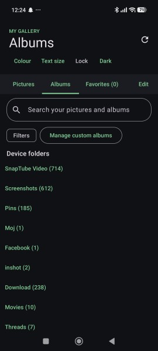
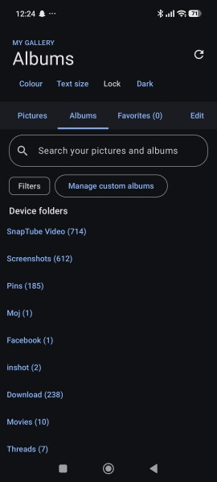
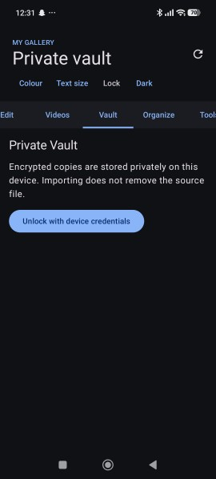
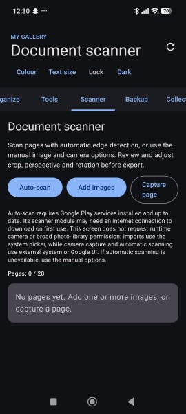

# My Gallery Pro

An independent Android gallery app built with Kotlin, Jetpack Compose, MediaStore, and Android platform APIs. No Samsung proprietary source, APK, or artwork is included.

## Tech stack

- Kotlin and Jetpack Compose (Material 3)
- Android MediaStore and platform APIs
- ML Kit (document scanner, text recognition, face detection) and TensorFlow Lite
- Media3 for video playback and trimming
- Gradle (Kotlin DSL), JDK 17, Android SDK 35, minimum Android 10 (API 29)

## Download

1. Open the **Actions** tab and pick the latest green run. The debug APK is in the **Artifacts** section as `MyGallery-debug-apk`.
2. Or open **Releases** for tagged versions such as `v1.0.0`, where the APK is attached.
3. On your phone, allow installs from your browser or file manager, then open the APK.

## Screenshots

<table>
  <tr>
    <td align="center"> Albums (green accent)</td>
    <td align="center"> Albums (blue accent)</td>
  </tr>
  <tr>
    <td align="center"> Private vault</td>
    <td align="center"> Document scanner</td>
  </tr>
</table>

## Continuous integration

Every push to `main` or `master` builds the debug APK with GitHub Actions. Pushing a tag that starts with `v` also publishes the APK as a GitHub Release. Unit tests run as a report-only step and do not block the build. Dependabot proposes monthly dependency updates.

## Build

Open the project in Android Studio with JDK 17 and Android SDK 35, or run `gradle :app:assembleDebug` with Gradle 8.9 and an installed Android SDK. Minimum Android version: Android 10 (API 29).

The project builds in GitHub Actions and runs on a physical Android device. Before distributing a release, test permissions, scanner availability, WebDAV requests, archive limits, vault memory use, and editor output on more devices.

## Features

### Gallery

- Full-screen photo/video viewer with swipe navigation, pinch/double-tap photo zoom, favorites, share, edit, and Android system trash.
- Photo/video timeline grouped by day or month, plus grid mode.
- Batch selection, favorite, share, album copy/move, and trash.
- Search and filters by media type, date range, folder, and favorites. Sort by newest, oldest, name, or largest.
- Dark, light, or system appearance, three accent colours, three text sizes, and optional app lock using the device screen lock.

### Photo editor

Image filters, brightness/contrast/saturation controls, rotate/flip, preset and freeform crop, drawing, an eraser, line/arrow/rectangle/ellipse and polygonal shapes, four text font families, and seven built-in glyph stickers. Overlays can be selected, moved, resized, recolored, or deleted individually. Rectangular blur and pixelation effects can be positioned and resized. Undo/redo covers adjustments and overlay changes. Saving creates a new image copy; the original remains unchanged. Blur and pixelation are visual effects, not a security guarantee for concealing sensitive information.

### Albums and smart collections

Create, rename, and delete custom albums. Select photos/videos and copy or move them into an album; moving asks Android for the required deletion consent before originals are removed. The Smart collections tab shows derived Recent (last 30 days), Favorites, Photos, Videos, and Large files (at least 100 MiB) collections without duplicating media.

### Private vault

Import photos or videos as encrypted copies. Unlock the vault using the device credential, preview photos or play videos from a private cache file, export a decrypted copy, or delete the encrypted vault item. Importing does not remove the source. Video playback is limited to encrypted files up to 512 MiB and temporarily stages authenticated plaintext in app-private cache; abandoned cache files are cleaned on a best-effort, 24-hour basis. Explicit export streams authenticated decryption into a pending MediaStore item and publishes it only after verification. Search, media-type filters, date/name sorting, and confirmed multi-delete are available. Keystore keys are device-bound and are not included in backups.

### Document scanner

Use Google Play services' automatic document scanner for page detection, or import images/capture pages manually. Reorder/remove pages, adjust rectangular crop insets, manually fine-tune all four corners for perspective correction, and export up to 20 ordered pages as one PDF. Pages are decoded to at most 1400 px on their longest side. OCR uses bundled ML Kit Latin-script recognition; recognized text can be searched and copied during the current scanner session. OCR text is not embedded in the exported PDF, which remains image-only. Automatic scanning requires compatible, up-to-date Google Play services and may need a network connection for first-use component delivery. Manual import/capture remains available if it is unavailable.

### Backup and restore

Back up or restore allowlisted app settings and custom-album definitions locally or through a WebDAV/Nextcloud HTTPS file URL. A separate selected-media archive can include photos/videos, be saved locally or uploaded over HTTPS, and be previewed before restoring selected entries. Media restore creates new copies in the app's restored Pictures/Movies folders and never deletes originals. Media archives are limited to 1,000 items, 1 GiB per item, and 2 GiB total; creation or remote restore may require temporary free storage of comparable size. Remote actions require confirmation and credentials are not saved. Vault data, device-bound keys, and favorites are not included in these backups.

### Other tools

Video trimming to a new copy, a storage breakdown, and an exact SHA-256 duplicate finder. Duplicate detection never deletes anything automatically.

## Safety and privacy notes

Vault import makes an encrypted copy; it does not remove the original. Video preview uses app-private staging for temporary decrypted bytes; abrupt process termination can leave a staging file until cleanup. Android system trash and move operations use Android's consent APIs where required. Review an archive before restoring it, and keep independent backups of important media.

## License

MIT for project-authored source. Third-party dependencies retain their respective licenses.
